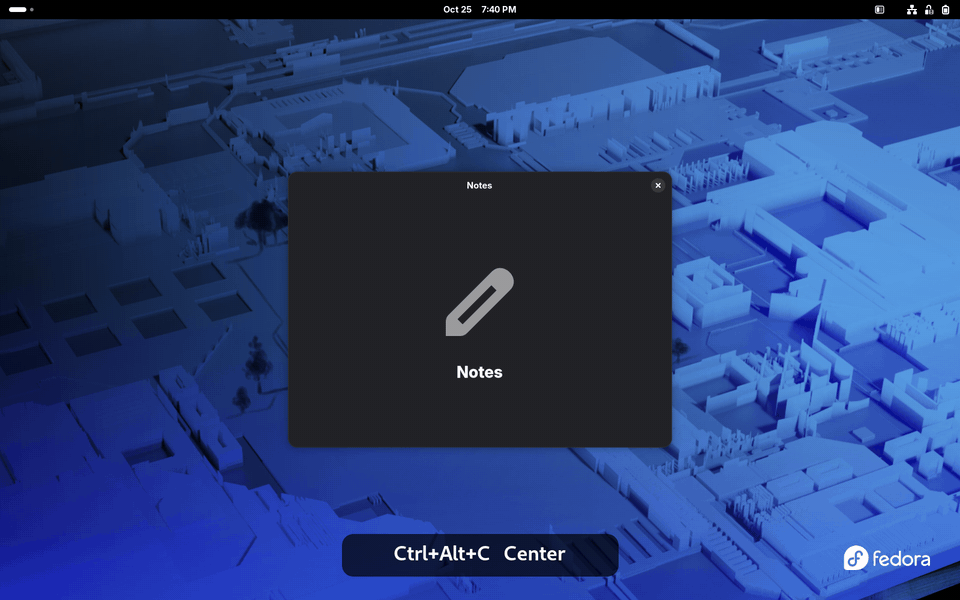
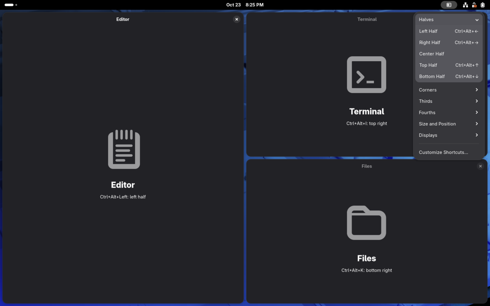
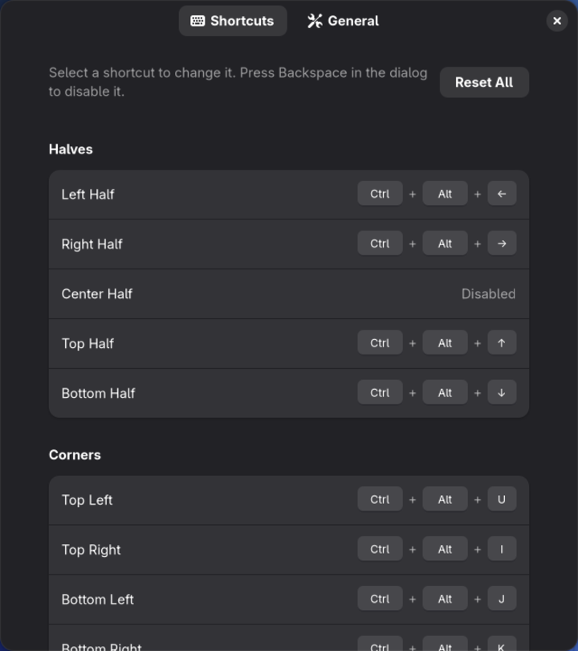

<p align="center">
  
</p>

<h1 align="center">Gnometangle</h1>

<p align="center">
  Keyboard-driven window snapping for GNOME Shell, modeled on
  <a href="https://github.com/rxhanson/Rectangle">Rectangle</a> for macOS.
</p>

<p align="center">
  <a href="https://github.com/aaronfeingold/gnometangle/releases/latest"></a>
  
  <a href="LICENSE"></a>
</p>

**What:** keyboard shortcuts that snap the focused window to a half, third, fourth or corner, center or maximize
it, or move it to another monitor or workspace.

**Why:** GNOME's built-in tiling covers halves and maximize. On wide and ultrawide monitors, thirds, fourths and a
centered window make that extra space useful.

**How:** Ctrl+Alt plus one key. Ctrl+Alt+Left for the left half, Ctrl+Alt+D / F / G for thirds, Ctrl+Alt+Enter to
maximize. Every shortcut can be changed. Works on Wayland and X11, GNOME Shell 45 through 51.

<p align="center">
  
</p>

## Install

Gnometangle is not on extensions.gnome.org yet, so you install it yourself, either from a release zip or from a
clone of this repository. Both take a couple of minutes and install only for your user, with no root needed.

Check your GNOME version first. It needs GNOME Shell 45 or later. CI runs an end-to-end test on GNOME 46, 49, 50 and 51
(Ubuntu) and GNOME 50 and 51 (Fedora 44 and 45) under Wayland, and it has also passed on GNOME 48.

```sh
gnome-shell --version
```

### From a release (easiest)

1. Download `gnometangle@aaronfeingold.github.io.shell-extension.zip` from the
   [latest release](https://github.com/aaronfeingold/gnometangle/releases/latest). Each release also has
   `SHA256SUMS` and a signed build attestation; see [SECURITY.md](SECURITY.md) to verify a download.
2. Install it:

   ```sh
   gnome-extensions install --force ~/Downloads/gnometangle@aaronfeingold.github.io.shell-extension.zip
   ```

3. Log out and back in. On Wayland, GNOME only loads new extension code at login. On X11 you can instead press
   Alt+F2, type `r` and press Enter.
4. Enable it:

   ```sh
   gnome-extensions enable gnometangle@aaronfeingold.github.io
   ```

The icon appears in the top bar. Try Ctrl+Alt+Left on any window.

### From source

Use this to run the latest code on `main`, or a branch. You need git, Node.js 22 or later (from your distribution,
[nodejs.org](https://nodejs.org/) or a version manager such as nvm), and pnpm (see
[pnpm.io/installation](https://pnpm.io/installation)).

```sh
git clone https://github.com/aaronfeingold/gnometangle.git
cd gnometangle
./scripts/install.sh
```

`scripts/install.sh` installs the dependencies, builds the extension, packs it into a zip and installs that zip for
your user. Then log out and back in, and enable it:

```sh
gnome-extensions enable gnometangle@aaronfeingold.github.io
```

If you would rather run the steps yourself:

```sh
pnpm install --frozen-lockfile
pnpm run pack
gnome-extensions install --force gnometangle@aaronfeingold.github.io.shell-extension.zip
```

### Update

Install the newer zip the same way (`--force` replaces the installed copy), or `git pull` and run
`./scripts/install.sh` again, then log out and back in. Your settings and shortcuts are kept.

### Check that it is running

```sh
gnome-extensions info gnometangle@aaronfeingold.github.io
```

`State: ACTIVE` (or `ENABLED` on older GNOME) means it is running. If it says `ERROR`, or the extension does not
show up after logging back in, the reason is in the shell log:

```sh
journalctl --user -b -o cat /usr/bin/gnome-shell | grep -i gnometangle
```

Please include that output if you [open an issue](https://github.com/aaronfeingold/gnometangle/issues).

### Uninstall

```sh
gnome-extensions uninstall gnometangle@aaronfeingold.github.io
```

If you turned on **Enable Overrides**, disabling or uninstalling the extension puts your GNOME shortcuts back.

## Top bar menu



Click the icon in the top bar for every action, grouped like the preferences window, with its current shortcut.
Choosing one snaps the window you were using, so the menu doubles as a cheat sheet while you learn the keys.
**Customize Shortcuts…** at the bottom opens the preferences window. The icon can be hidden in the preferences.

## Shortcuts

Rectangle uses Ctrl+Option on macOS. Here that is **Ctrl+Alt**. Every shortcut can be changed or disabled in the
preferences window.

| Action                                            | Default                        |
| ------------------------------------------------- | ------------------------------ |
| Left / Right half                                 | Ctrl+Alt+Left / Right          |
| Top / Bottom half                                 | Ctrl+Alt+Up / Down             |
| Center half                                       | unset                          |
| Top left / Top right / Bottom left / Bottom right | Ctrl+Alt+U / I / J / K         |
| First / Center / Last third                       | Ctrl+Alt+D / F / G             |
| First / Last two thirds                           | Ctrl+Alt+E / T                 |
| Center two thirds                                 | unset                          |
| First / Second / Third / Last fourth              | Ctrl+Alt+1 / 2 / 3 / 4         |
| First / Center / Last three fourths               | unset                          |
| Maximize                                          | Ctrl+Alt+Enter                 |
| Almost maximize                                   | unset                          |
| Maximize height                                   | Ctrl+Alt+Shift+Up              |
| Make smaller / Make larger                        | Ctrl+Alt+Minus / Equal         |
| Smaller / Larger width, Smaller / Larger height   | unset                          |
| Center                                            | Ctrl+Alt+C                     |
| Restore                                           | Ctrl+Alt+Backspace             |
| Move left / right / up / down                     | unset                          |
| Send to workspace 1–9                             | unset                          |
| Send to previous / next workspace                 | Ctrl+Alt+Shift+Left / Right    |
| Next / Previous display                           | Ctrl+Alt+Super+Right / Left    |
| Display on the left / right, above / below        | unset                          |
| Display 1 / 2 / 3                                 | unset                          |
| Focus next / previous display                     | unset                          |
| Identify displays                                 | unset, and in the top bar menu |
| Rotate display right / left, reset rotation       | unset                          |

Behaviour borrowed from Rectangle:

- Pressing a half shortcut again cycles the width (or height) through 1/2, 2/3 and 1/3. First third and last third
  cycle through the three thirds.
- Thirds and fourths stack vertically on portrait monitors.
- Restore puts the window back where it was before the first snap.
- Moving to another display keeps a snapped window's layout and a floating window's size, also between displays with
  different scales (such as a 2x laptop panel next to a 1x monitor).
- Next and previous display go through the displays left to right. The direction actions pick the nearest display
  that way in your monitor layout, and Display 1, 2 and 3 are numbered left to right, then top to bottom.
  **Identify Displays** shows each number on its display for a moment.
- Focus next / previous display focuses the top window on that display without moving anything.
- Rotate display right and left turn the display the window is on a quarter turn, for a laptop on its side or a
  monitor on a pivot stand; reset rotation turns it back to landscape. Other displays stay on and move up to stay
  next to it, and its windows stay on it, snapped ones keeping their layout. Like Settings' Displays panel without
  its confirm step, the rotation lasts until the next display change, such as plugging in a monitor.
- Make larger and make smaller keep edges that touch the screen pinned, so a left-half window grows to the right.
  The width and height versions do the same along one axis.
- Move left, right, up and down slide the window to that edge of the screen without resizing it.
- Sending a window to another workspace keeps its size and position, so a snapped window stays snapped. By default
  you follow it there. Sending to a workspace that doesn't exist yet creates it; with GNOME's dynamic workspaces,
  GNOME then removes any empty ones in between, so the window lands on a new workspace after the ones in use.
  Previous and next stop at the first and last workspace.

## Customize shortcuts



Every shortcut can be changed or disabled:

1. Open **Customize Shortcuts…** from the top bar menu.
2. Select an action (or start typing its name to search) and press the new keys. Backspace disables it, Esc cancels.
3. The undo button next to a shortcut, or **Reset All**, brings back the defaults.

If the keys you pick are already used by another Gnometangle action, they are moved to the new one, and a notice
says which action lost them.

A warning icon marks a shortcut that won't work reliably, in the preferences and in the top bar menu, with the reason:
another GNOME shortcut or one of your custom shortcuts uses the same keys (only one of them runs), or GNOME refused
to register it. Click the icon in the preferences to choose other keys.

<br clear="right">

## Settings

Open them from the top bar menu (**Customize Shortcuts…**) or with
`gnome-extensions prefs gnometangle@aaronfeingold.github.io`.

- Show the icon in the top bar (on by default).
- Gap size between windows and around screen edges.
- Cycle sizes on repeat (on by default).
- Almost maximize size (90 percent by default).
- Resize step for make larger and make smaller.
- Follow windows to other workspaces (on by default).
- Enable overrides (off by default), described below.
- Ignored apps: while one of them has focus, Gnometangle's shortcuts are turned off so the app gets those keys.
  The top bar menu still works on its windows.

## Enable overrides

Gnometangle keeps every layout under one hand position, Ctrl+Alt plus a key, so you can snap windows without
stretching for an extra modifier. Some of Gnometangle's default shortcuts are also GNOME shortcuts. Gnometangle doesn't change your GNOME shortcuts
unless you ask it to, so with the defaults both claim these keys and only one of the two actions runs:

| Keys                        | GNOME action                           | Gnometangle action                |
| --------------------------- | -------------------------------------- | --------------------------------- |
| Ctrl+Alt+Left / Right       | Switch to workspace left / right       | Left / Right half                 |
| Ctrl+Alt+Up / Down          | Switch to workspace up / down          | Top / Bottom half                 |
| Ctrl+Alt+Shift+Up           | Move window one workspace up           | Maximize height                   |
| Ctrl+Alt+Shift+Left / Right | Move window one workspace left / right | Send to previous / next workspace |

To let Gnometangle have them, turn on **Enable Overrides** in the **General** page of the preferences, or run:

```sh
gsettings --schemadir ~/.local/share/gnome-shell/extensions/gnometangle@aaronfeingold.github.io/schemas \
  set org.gnome.shell.extensions.gnometangle override-conflicts true
```

It takes effect right away, with no logout needed. While it is on, the extension removes only the GNOME entries that
use the same keys as its own shortcuts, including any you set yourself. Other keys on those GNOME actions (such as
Super+Page Up) keep working. Turning it off, or disabling the extension, puts them back, except for any of those GNOME
shortcuts you changed yourself in the meantime, which keep your change. The originals are saved before anything
changes, so they are also restored on the next start if the shell ever exits without disabling the extension.

The other way around works too: leave it off and give the Gnometangle actions different keys in the preferences.

On Ubuntu, Ctrl+Alt+T opens a terminal. That binding lives in a different place and is not overridden, so "Last Two
Thirds" shows a warning. Rebind it (or the terminal shortcut) if you want both.

## Contributing

Contributions are welcome: bug reports, ideas, and pull requests. [CONTRIBUTING.md](CONTRIBUTING.md) covers the
development setup, how the code is organized, how to add an action, and the test suites. Good places to start are
issues labeled [good first issue](https://github.com/aaronfeingold/gnometangle/labels/good%20first%20issue) and
[enhancement](https://github.com/aaronfeingold/gnometangle/labels/enhancement).

## Roadmap

- Drag-to-edge snap areas
- User-defined layouts
- Per-application rules
- Publish on extensions.gnome.org

## License

MIT. Gnometangle is an independent project and is not affiliated with Rectangle or its authors.
